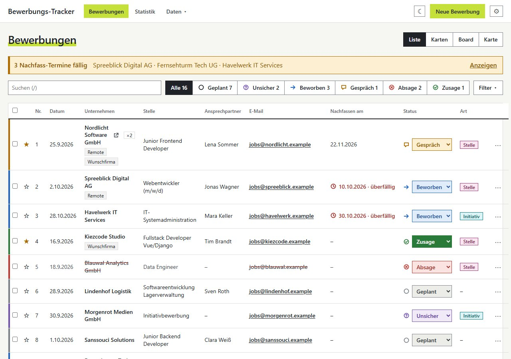
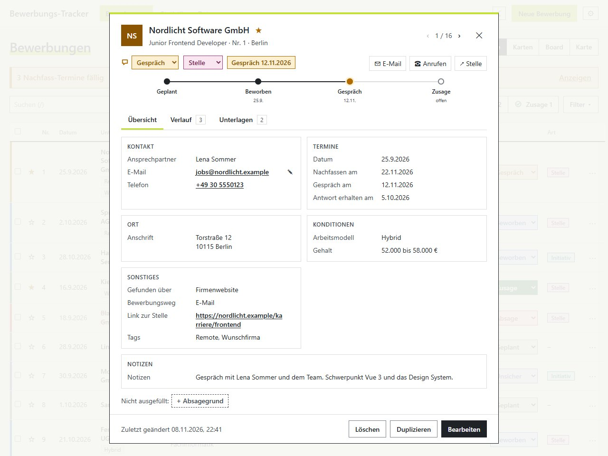
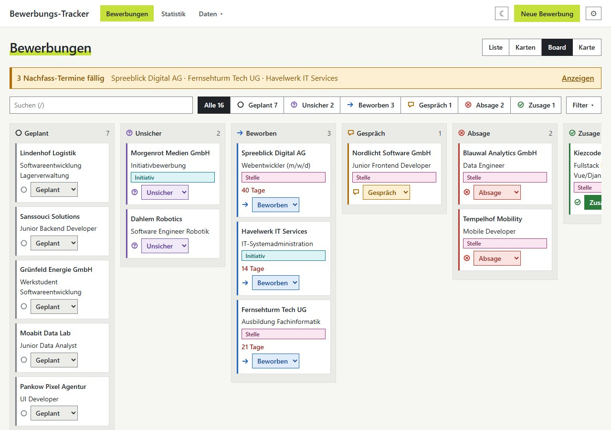
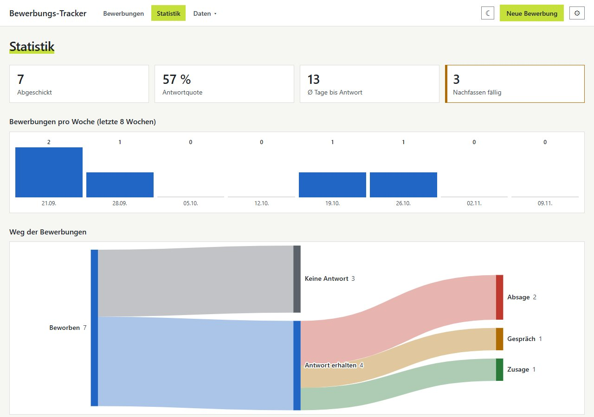
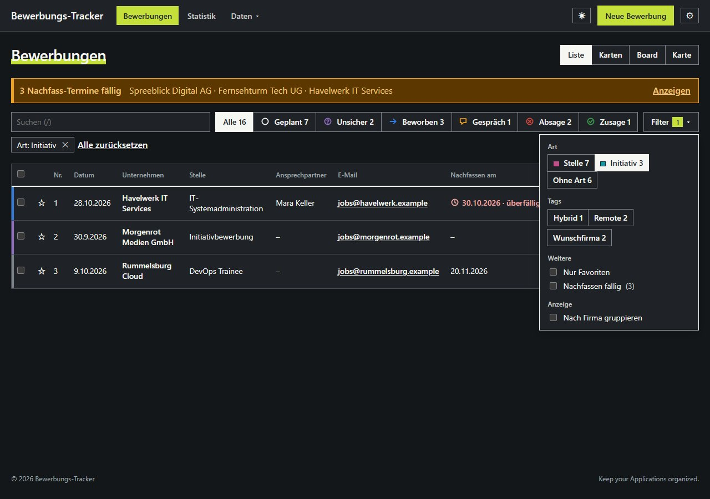
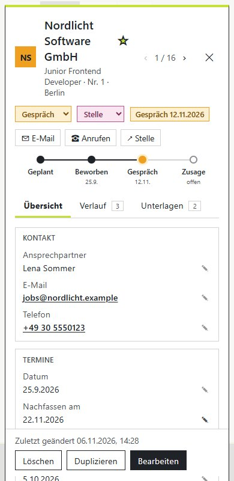

# Application Tracker

[](https://github.com/TranceMeli/ApplicationTracker/actions/workflows/tests.yml)


A web app for people who apply for jobs: it keeps every application from the first contact to the final answer in one place, with the status, the dates to remember and the documents you sent. It runs on your own computer and stores everything locally. The backend is a Django REST API with a SQLite database, the frontend is a Vue 3 single-page app built with Vite.

The project is under active development, so features and the data model may still change. The app has no login and is meant for local use (see [Security](docs/API.md#notes)).

<p align="center">
  
  
</p>
<p align="center">
  
  
</p>
<p align="center">
  
  
</p>

The screenshots show fictitious demo data; companies, people and addresses are made up.

## Features

- **Track applications** with company, position, contact person, dates, status, tags, notes and a history of every status change. The status workflow is planned, unsure, applied, interview, rejected and offer, shown by color, icon and text.
- **Today panel** with the follow-ups that are due, the next interviews and the applications that have waited more than 21 days for an answer.
- **Documents in one place:** drop files anywhere on the page or paste them with Ctrl+V. The inbox proposes the application, the kind (cover letter, CV, certificate, complete application) and a file name such as `2026-11-17_Müller_GmbH_Anschreiben.pdf`. PDFs, images and text open in a viewer.
- **Four views** (list, cards, board with drag and drop, map) with live search, filters and a result count, sortable columns, favorites and bulk actions. Deleted entries stay in a trash for 7 days and a message offers "Undo".
- **Quick add:** paste the link of a job posting and the company is read from it. Forms show errors at the field, keep a draft and ask before unsaved entries are thrown away.
- **Statistics** with the response rate, the days until an answer and a Sankey diagram from sending to the outcome.
- **Your data stays yours:** CSV, XLSX, ODS and JSON import with a preview, CSV export, a calendar file (.ics) for follow-ups and interviews, and backups of the database and the uploaded files.
- **Accessible and configurable:** light and dark theme, German and English interface, keyboard access, WCAG AA contrast, a layout for phones, and fields that can be switched on and off or moved between sections.

The complete list is in [docs/FEATURES.md](docs/FEATURES.md).

## Prerequisites

- Python 3.12 or newer with `pip` and `venv`
- Node.js 20 or newer with `npm`
- No database server and no account: SQLite ships with Python. Two optional features contact outside services: the address lookup (OpenStreetMap Nominatim) and the company logos (DuckDuckGo, off by default).

## Installation

```bash
git clone https://github.com/TranceMeli/ApplicationTracker.git
cd ApplicationTracker

# Backend
cd backend
python -m venv .venv
.venv\Scripts\activate            # Windows
# source .venv/bin/activate       # macOS and Linux
pip install -r requirements.txt
python manage.py migrate

# Frontend
cd ../frontend
npm install
```

`manage.py` uses the Python of `backend/.venv` by itself if it exists, so activating the environment is optional.

## Quick start

Start the backend first and the frontend in a second terminal:

```bash
cd backend
python manage.py runserver
```

```bash
cd frontend
npm run dev
```

Open http://localhost:5173. Without an address `runserver` takes the first free port from 8000 on and writes it to `backend/.port`, where the frontend finds it. If you start Django on a port of your own, tell the frontend with `API_URL` (see [Configuration](#configuration)).

## Usage

1. Press **New application**, paste the link to a job posting and the company is filled in. Add the position, choose Planned or Applied and press **Add**.
2. Click a row to open the details. Change the status in the header; the history logs it. Drop the cover letter and CV on the page, check the proposed company and name, and file them.
3. Come back to the **Today panel**: it tells you which follow-ups are due and which applications have been quiet for too long.

More, such as import and export, the views, fields and keyboard use, is in the [usage guide](docs/USAGE.md).

## Configuration

Everything works without configuration. These variables change the defaults:

| Variable | Used by | Description | Default |
|---|---|---|---|
| `API_URL` | frontend dev server | Address of the Django backend | read from `backend/.port`, otherwise `http://localhost:8000` |
| `TRACKER_DATA_DIR` | backend | Folder for the database, the uploaded files and the backups | the `backend/` folder |
| `TRACKER_FRONTEND_DIR` | backend | Folder of the built frontend that the backend serves at `/` | `frontend/dist` |
| `E2E_BROWSER` | browser tests | `chromium` uses the bundled browser instead of Microsoft Edge | Microsoft Edge |
| `E2E_WEB_PORT`, `E2E_API_PORT` | browser tests | Ports of the frontend and the backend started for the tests | 5190 and 8021 |

```bash
API_URL=http://localhost:8001 npm run dev          # macOS, Linux, Git Bash
$env:API_URL="http://localhost:8001"; npm run dev  # PowerShell
```

Restart the dev server after changes to `vite.config.js`. The display settings (theme, language, fields, home address) are stored in the browser, not on the server. The Django settings, including `DEBUG` and `SECRET_KEY`, are in `backend/config/settings.py` and are set up for local use.

## Tests

The tests have three layers: Django tests for the API, Vitest for the frontend logic and Playwright for the real app in the browser. They run on every push through GitHub Actions.

```bash
cd backend && python manage.py test        # API
cd frontend && npm test                    # frontend logic
cd frontend && npm run test:e2e            # browser tests
```

The browser tests start their own backend and frontend with a throw-away database, so your real data is never touched. What each layer covers and how to write new tests is in [TESTING.md](TESTING.md).

## Contributing

Bug reports and ideas are welcome. How to set up the project, run the tests and what to keep in mind is in [CONTRIBUTING.md](CONTRIBUTING.md). Technical background is in [docs/DEVELOPMENT.md](docs/DEVELOPMENT.md), the REST API is described in [docs/API.md](docs/API.md).

## Help and support

Questions and bugs go to the [issue tracker](https://github.com/TranceMeli/ApplicationTracker/issues). Please say which operating system and browser you use and, for a bug, which steps lead to it.

## License

No license has been chosen yet, so all rights are reserved by the author.
