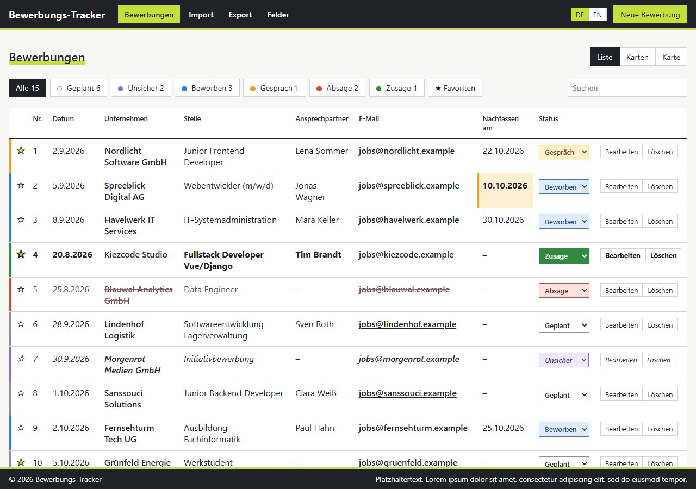
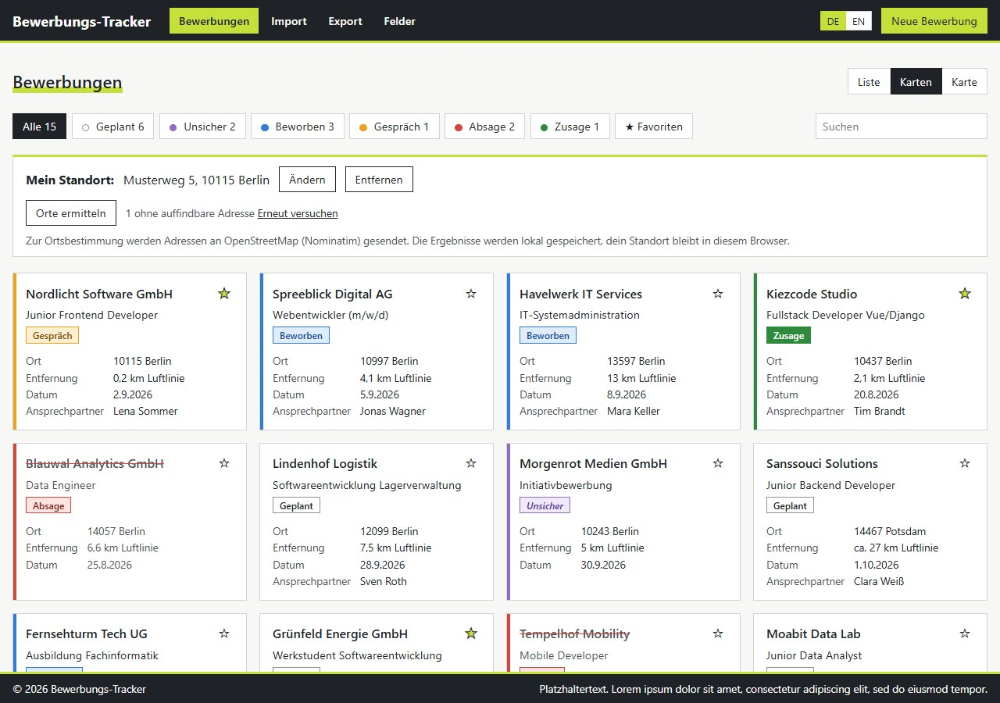
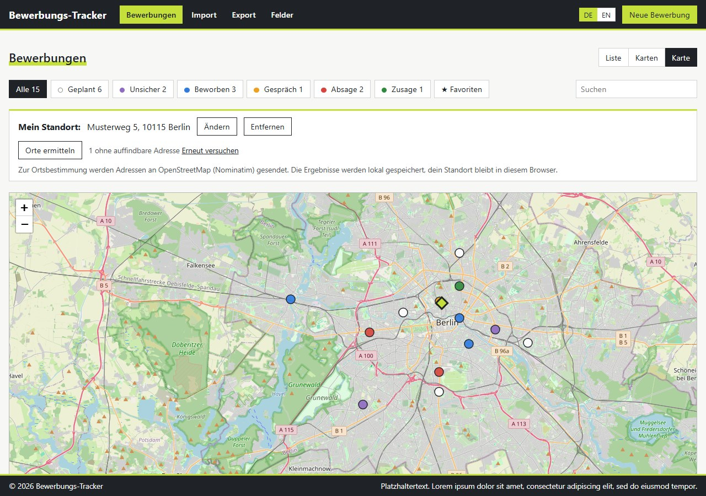

# Application Tracker


## Preview

<p align="center">
  
  
</p>
<p align="center">
  
</p>

The screenshots show fictitious demo data; companies, people and addresses are made up.

A web app to keep track of job applications, from the first contact to the final answer. The backend is a Django REST API with a SQLite database, the frontend is a Vue 3 single-page app built with Vite.

This project is under active development. Features and the data model may still change.

## Features

- Track applications with company, position, contact person, dates, status, notes and more
- Status workflow: planned, unsure, applied, interview, rejected, offer
- Favorites with a star marker and a favorites filter
- Live search (company, position, contact person, email, phone, city, notes) and status filter with counters
- Status colors that are the same in the table, on the cards and on the map
- Consecutive numbering of the applications in the table and detail view
- Detail view in a modal dialog
- Highlighting of overdue follow-ups (applications with status applied whose follow-up date has passed)
- Configurable fields: choose which columns appear in the table and which fields appear in the form and detail view. Hidden fields are not deleted, their data stays stored and can be shown again at any time
- Extra fields: source, application channel, work model, salary, interview date, response date, rejection reason
- Document attachments per application (cover letter, CV, certificate, other)
- List, card and map views for applications
- Optional home address stored in the browser, with approximate distances to application locations
- Address lookup through OpenStreetMap Nominatim; coordinates and lookup status are saved with applications
- Company list import from CSV, TSV, TXT, XLSX, XLSM, ODS and JSON, with a dry-run preview and a choice to update existing applications or import only new companies
- CSV export of all applications with every field (also the hidden ones), in the same format as the import template, so an export can be imported again
- Header with navigation and a footer that stays at the bottom of the window
- German and English interface with a language switch, the choice is remembered in the browser

## Tech Stack

| Layer | Technology |
|---|---|
| Frontend | Vue 3 (Composition API), Vite, Leaflet, plain CSS |
| Backend | Django, Django REST Framework, django-cors-headers |
| Database | SQLite |
| File storage | Local filesystem (`backend/media/`) |
| Import | openpyxl for Excel files, standard library for CSV, ODS and JSON |

## Dependencies

### Backend (Python)

Listed in `backend/requirements.txt`:

| Package | Version | Purpose |
|---|---|---|
| Django | >= 5.0 | Web framework, ORM, migrations, admin |
| djangorestframework | >= 3.15 | REST API (serializers, viewsets, routers) |
| django-cors-headers | >= 4.4 | Allows the Vite dev server to call the API |
| openpyxl | >= 3.1 | Reads Excel files (.xlsx, .xlsm) during import |

Django pulls in `asgiref`, `sqlparse` and (on Windows) `tzdata` automatically. SQLite needs no separate installation, it ships with Python. ODS files are read with the standard library, no extra package is needed.

```bash
pip install -r requirements.txt
# or
pip install django djangorestframework django-cors-headers openpyxl
```

### Frontend (Node.js)

Listed in `frontend/package.json`:

| Package | Version | Type | Purpose |
|---|---|---|---|
| vue | ^3.5.42 | dependency | UI framework |
| leaflet | ^1.9.4 | dependency | Interactive map |
| vite | ^8.3.0 | dev dependency | Dev server and build tool |
| @vitejs/plugin-vue | ^6.0.8 | dev dependency | Vue single-file component support for Vite |

```bash
npm install
# or, when setting the project up from scratch
npm install vue leaflet
npm install -D vite @vitejs/plugin-vue
```

No router, state management library or HTTP client is used. Routing is not needed, state lives in `App.vue` and requests use the built-in `fetch`.

## Project Structure

```
application-tracker/
├── backend/
│   ├── manage.py
│   ├── requirements.txt
│   ├── config/                 Django project settings and root URLs
│   └── application/
│       ├── models.py           Application and Attachment models
│       ├── serializers.py      API serializers and upload validation
│       ├── views.py            ViewSets, filtering, statistics, import endpoint
│       ├── importer.py         File readers and company list import
│       ├── geocoding.py        Address lookup with OpenStreetMap Nominatim
│       ├── urls.py             API routes
│       ├── admin.py            Admin with attachments as inline
│       └── tests.py            API, attachment and import tests
└── frontend/
    ├── package.json
    ├── vite.config.js          Dev server with proxy to the backend
    └── src/
        ├── main.js
        ├── App.vue             Layout (header, footer), state and data loading
        ├── api.js              API client
        ├── constants.js        Status keys and date helpers
        ├── geo.js              Map state, geocoding and distance helpers
        ├── fields.js           Field catalog and visibility settings
        ├── exporter.js         CSV export and import template download
        ├── i18n.js             German and English texts
        ├── style.css           Color palette (CSS variables) and layout
        └── components/
            ├── FilterBar.vue
            ├── ApplicationTable.vue
            ├── ApplicationForm.vue
            ├── DetailModal.vue
            ├── FieldSettings.vue
            ├── ImportDialog.vue
            ├── LanguageSwitch.vue
            ├── CompanyCards.vue
            ├── CompanyMap.vue
            └── GeoBar.vue
```

## Getting Started

### Prerequisites

- Python 3 (a recent version, 3.12 or newer recommended) with `pip` and `venv`
- Node.js 20 or newer with `npm`

### Backend

```bash
cd backend
python -m venv .venv
.venv\Scripts\activate            # Windows
# source .venv/bin/activate       # macOS and Linux

pip install -r requirements.txt
python manage.py migrate
python manage.py runserver
```

The API runs on http://localhost:8000; the root URL redirects to the API overview at `/api/`. If port 8000 is taken, start it on another port, for example `python manage.py runserver 8001`, and point the frontend to it (see below). An admin user is optional and only needed for `/admin`:

```bash
python manage.py createsuperuser
```

### Frontend

In a second terminal:

```bash
cd frontend
npm install
npm run dev
```

Open http://localhost:5173. The dev server proxies `/api` and `/media` to Django on port 8000, so both servers must be running. If Django runs on another port, set `API_URL`:

```bash
API_URL=http://localhost:8001 npm run dev        # macOS, Linux, Git Bash
$env:API_URL="http://localhost:8001"; npm run dev  # PowerShell
```

Restart the dev server after changes to `vite.config.js`.

### Tests

```bash
cd backend
python manage.py test
```

The tests cover the API (search, ordering, file cleanup), attachment uploads and the import.

## Usage

- **Navigation:** the header gives access to the list, the import, the export and the field settings. The application name and the Applications entry reset search and filters.
- **New application:** use the button in the header. Only the company is required.
- **Status:** change it directly in the table, or filter by it with the buttons above the table. Each status has its own color: planned (gray), unsure (violet), applied (blue), interview (amber), rejected (red, name crossed out) and offer (green). The colors are defined as CSS variables at the top of `frontend/src/style.css`.
- **Favorites:** click the star in the table. The favorites button filters the list.
- **Details:** click a row to open the detail dialog. There you can also edit, delete and manage documents.
- **Fields:** the Fields entry lets you choose the visible table columns and the visible form fields. The company and the status are always shown. The selection is stored in the browser.
- **Documents:** open an application, pick a type and attach files. Allowed types are PDF, Word, ODT, TXT, PNG and JPG, up to 10 MB per file.
- **Import:** open Import, download the template if needed, choose a file and review the dry-run preview before importing. Supported formats are `.csv`, `.tsv`, `.txt`, `.xlsx`, `.xlsm`, `.ods` and `.json`, up to 5 MB. German and English column names are recognized; unknown columns are shown as ignored. Choose whether to add new companies and update existing applications or import new companies only. Existing companies are matched case-insensitively after whitespace normalization. In update mode, non-empty imported values update the oldest matching application; empty cells do not erase saved data. Repeated companies in the same file are counted as duplicates.
- **Export:** the Export entry downloads all applications as a CSV file (semicolon separated, UTF-8 with BOM, opens directly in Excel and LibreOffice). The file uses the same columns as the import template.
- **Views and locations:** switch between list, cards and map. In cards or map view, you can optionally enter your home address to see distances; it is stored only in this browser. Use the location lookup to geocode application addresses. Addresses are sent to OpenStreetMap Nominatim, and coordinates and lookup status are saved with the application. Requests are rate-limited; a batch may take several seconds. Applications without a match can be retried.
- **Language:** switch between DE and EN in the header.

## API

| Method | Endpoint | Description |
|---|---|---|
| GET, POST | `/api/applications/` | List (`?search=`, `?status=`, `?channel=`, `?work_mode=`, `?favorite=1`, `?ordering=`) and create |
| GET, PATCH, DELETE | `/api/applications/<id>/` | Read, update and delete one application; deleting also removes its files |
| GET | `/api/applications/stats/` | Number of applications per status |
| POST | `/api/applications/import/` | Preview or import a company list (multipart: `file`, optional `dry_run`, `default_status`, `mode`) |
| POST | `/api/applications/geocode/` | Geocode a batch of application addresses; send `{"retry":"1"}` to retry failed lookups |
| POST | `/api/geocode/` | Look up one address without saving it on the server |
| GET, POST | `/api/attachments/` | List (`?application=<id>`) and upload a file (multipart: `application`, `file`, `kind`) |
| DELETE | `/api/attachments/<id>/` | Remove an attachment and its file |

Uploaded files are served under `/media/` while `DEBUG` is on. Files are removed from disk whenever their attachment is deleted, also through the admin or when the application is deleted.
Error responses carry codes (for example `file_type` or `no_company_column`) that the frontend translates.
Geocoding uses the external OpenStreetMap Nominatim service and must follow its usage policy. It is rate-limited and is not intended for high-volume geocoding.

## Extending the App

To add a new field:

1. Add it to the `Application` model in `backend/application/models.py` and run `python manage.py makemigrations application` followed by `python manage.py migrate`.
2. Add an entry to the `FIELDS` list in `frontend/src/fields.js`.
3. Add its label to both languages in `frontend/src/i18n.js`.
4. Optionally add column aliases to `FIELD_ALIASES` in `backend/application/importer.py` so the field is recognized during import.

The table, form, detail view, field settings dialog and the CSV export pick it up automatically. A new language is added as another block in `i18n.js`.

## Notes

- The app has no authentication and is meant for local use. Uploaded documents are served without login. Session authentication is switched off for the API, so a login to the Django admin does not cause CSRF errors in the app. Add authentication and configure production settings (including `DEBUG`, `SECRET_KEY` and `ALLOWED_HOSTS`) before exposing it to a network.
- A backup consists of `backend/db.sqlite3` and the folder `backend/media/`.
- The `.gitignore` excludes the virtual environment, `node_modules`, the build output, the SQLite database, the media folder, `.env` files and local editor and Claude Code settings, so personal data stays out of the repository.
