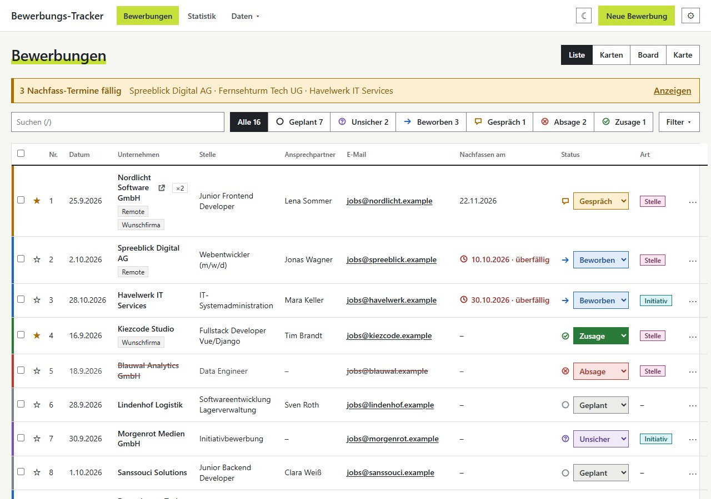
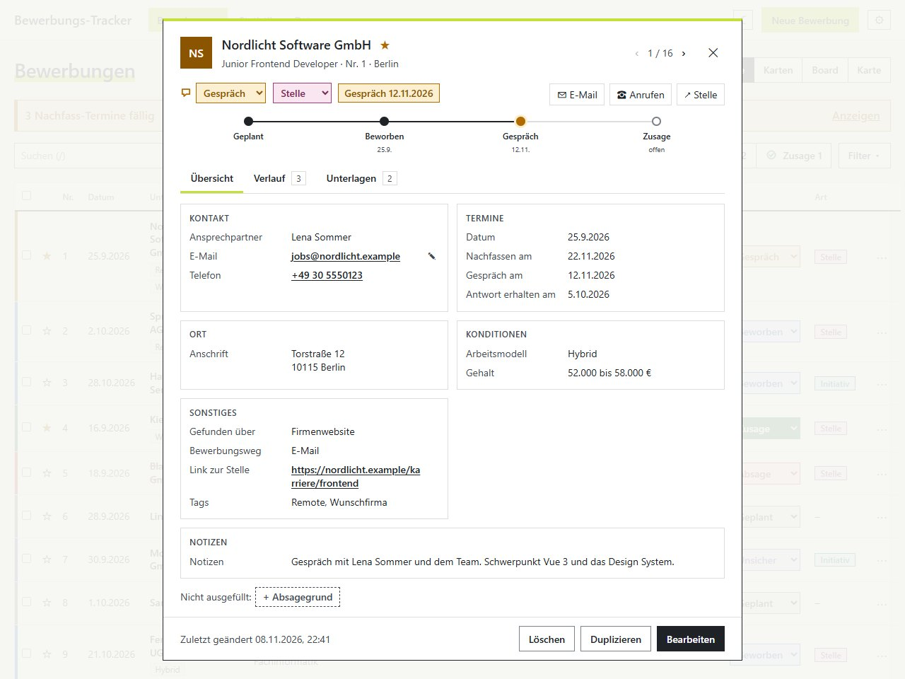
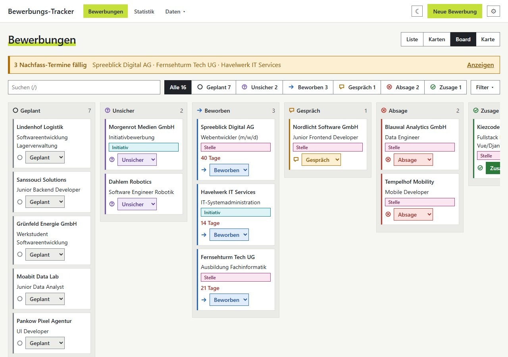
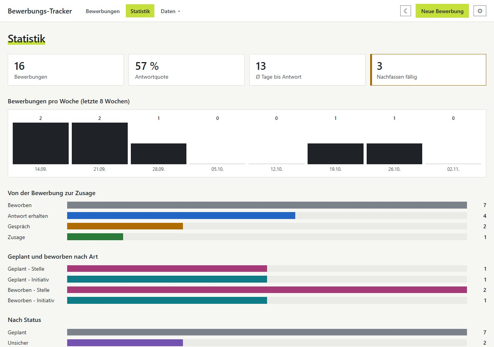
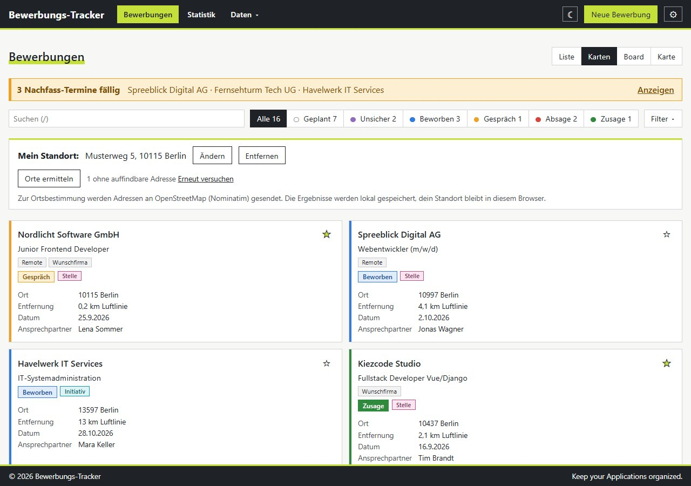
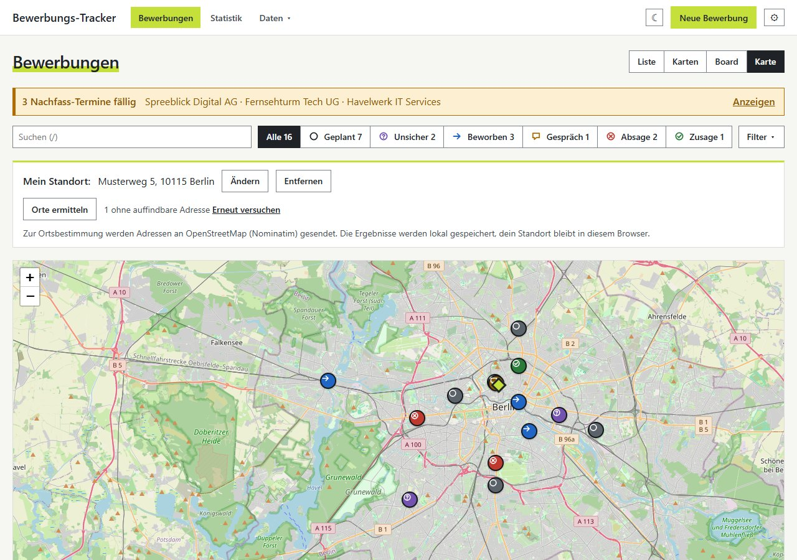
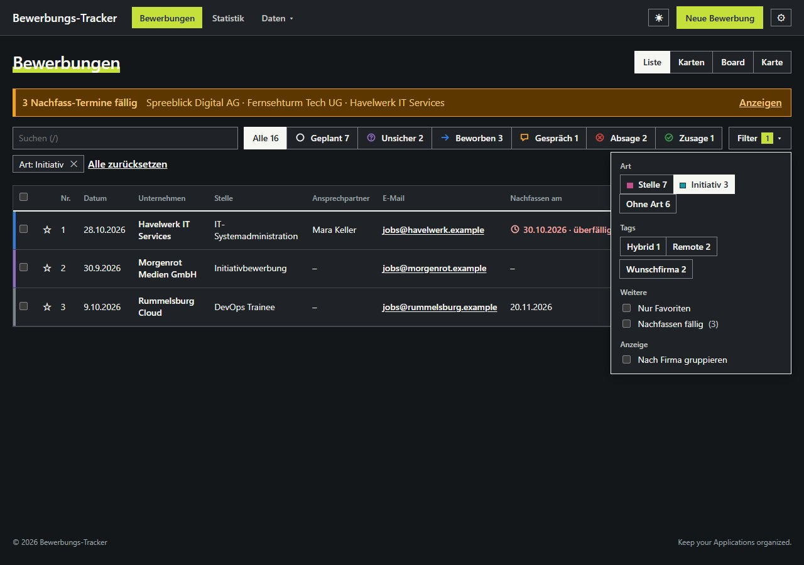
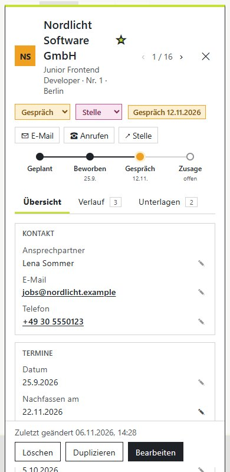

# Application Tracker


## Preview

<p align="center">
  
  
</p>
<p align="center">
  
  
</p>
<p align="center">
  
  
</p>
<p align="center">
  
  
</p>

The screenshots show fictitious demo data; companies, people and addresses are made up.

A web app to keep track of job applications, from the first contact to the final answer. The backend is a Django REST API with a SQLite database, the frontend is a Vue 3 single-page app built with Vite.

This project is under active development. Features and the data model may still change.

## Features

- Track applications with company, position, contact person, dates, status, notes and more
- Status workflow: planned, unsure, applied, interview, rejected, offer
- Type per application, chosen from a menu in addition to the status and empty until set: "Stelle" (answer to a job posting, rose) or "Initiativ" (unsolicited, teal). Together with the status this gives combinations such as Planned - Initiativ or Applied - Stelle; there are filter chips for each type and for applications without one, a column in the table, a badge on the cards and the board, and a bulk change
- Favorites with a star marker and a favorites filter
- Compact toolbar: live search (company, position, contact person, email, phone, city, notes; the slash key jumps to it), status segments with counters and a Filter menu for the type, tags, favorites, due follow-ups and grouping; the active filters stay visible as chips that can be removed one by one
- Status shown by color, icon and text (never by color alone): the same badges in the table, on the cards, on the board and as pins on the map
- Design based on the colour and typography research: fixed colour and type scales as tokens in `style.css` (neutral scale, one lime accent, four signal colours), text and control contrast checked against WCAG AA (4.5:1 text, 3:1 borders), a type scale of six sizes with 16 px body text, a separate dark palette, a visible focus ring, 44 px touch targets and 16 px inputs on phones, and reduced motion respected
- Consecutive numbering of the applications in the table and detail view
- Detail view with the status, type and next date in the header, quick actions (mail, call, open the posting), a bar that shows the way from planned to offer, tabs for the overview, the history and the documents, the fields in sections and arrows to go through the applications; a field is changed by clicking it
- Follow-up reminders: a banner lists the applications whose follow-up date has come (status applied) and narrows the list to them with one click, overdue dates are highlighted in the table
- Sortable table columns (click a column header; the numbering stays with the application) and an optional grouping by company, a badge shows when a company has several applications
- Select several applications to change their status or delete them at once
- Deleting moves an application to a trash for 7 days, a message offers "Undo"; older entries are purged for good together with their files
- History per application: status changes are logged automatically, notes with a date can be added in the detail view
- Tags per application (comma separated, shown as chips, filter above the list); a warning appears in the form when the company already exists
- Configurable fields: choose which columns appear in the table and which fields appear in the form and detail view, and arrange the fields of the detail view in sections (reorder them, move fields between them, add sections of your own). Hidden fields are not deleted, their data stays stored and can be shown again at any time
- Extra fields: source, application channel, work model, salary, interview date, response date, rejection reason
- Document attachments per application (cover letter, CV, certificate, other)
- List, card, board and map views for applications; the board shows one column per status and moves an application when its card is dragged to another column
- Statistics page: response rate, average days to an answer, applications per week and the way from application to offer
- Calendar export (.ics) of follow-up dates and interview dates
- Dark mode that follows the system setting and can be chosen in the settings menu (System, Light, Dark) or switched with the moon or sun button; responsive layout with a floating add button on small screens
- Optional home address stored in the browser, with approximate distances to application locations
- Address lookup through OpenStreetMap Nominatim; coordinates and lookup status are saved with applications
- Optional company logos in the table, on the cards and in the detail view (off by default, switch on under Fields); the initials in the status color are shown when a company has no icon
- Company list import from CSV, TSV, TXT, XLSX, XLSM, ODS and JSON, with a dry-run preview and a choice to update existing applications or import only new companies
- CSV export of all applications with every field (also the hidden ones), in the same format as the import template, so an export can be imported again
- Backups: a download of the database and the uploaded files from the Data menu, and an automatic backup once a day when the server starts (the last 14 are kept in `backend/backups/`)
- Light header that stays in view, with the Applications and Statistics pages, a Data menu (import, export, calendar, backup) and a settings menu (fields, theme, language); the table header stays in view while scrolling
- Table rows are reachable by keyboard (the company name opens the details, the arrow icon the posting, the three-dot menu edits or deletes)
- Clear states: a placeholder while loading, a first-run page, a "no matches" page with a reset button and a retry page when the server is unreachable
- The form keeps company, position, status and type on top, the other fields fold away in sections that start open when they already have data
- German and English interface with a language switch, the choice is remembered in the browser

## Tech Stack

| Layer | Technology |
|---|---|
| Frontend | Vue 3 (Composition API), Vite, Leaflet, plain CSS |
| Backend | Django, Django REST Framework, django-cors-headers |
| Database | SQLite |
| File storage | Local filesystem (`backend/media/`) |
| Import | openpyxl for Excel files, standard library for CSV, ODS and JSON |

## Dependencies

### Backend (Python)

Listed in `backend/requirements.txt`:

| Package | Version | Purpose |
|---|---|---|
| Django | >= 5.0 | Web framework, ORM, migrations, admin |
| djangorestframework | >= 3.15 | REST API (serializers, viewsets, routers) |
| django-cors-headers | >= 4.4 | Allows the Vite dev server to call the API |
| openpyxl | >= 3.1 | Reads Excel files (.xlsx, .xlsm) during import |

Django pulls in `asgiref`, `sqlparse` and (on Windows) `tzdata` automatically. SQLite needs no separate installation, it ships with Python. ODS files are read with the standard library, no extra package is needed.

```bash
pip install -r requirements.txt
# or
pip install django djangorestframework django-cors-headers openpyxl
```

### Frontend (Node.js)

Listed in `frontend/package.json`:

| Package | Version | Type | Purpose |
|---|---|---|---|
| vue | ^3.5.42 | dependency | UI framework |
| leaflet | ^1.9.4 | dependency | Interactive map |
| vite | ^8.3.0 | dev dependency | Dev server and build tool |
| @vitejs/plugin-vue | ^6.0.8 | dev dependency | Vue single-file component support for Vite |

```bash
npm install
# or, when setting the project up from scratch
npm install vue leaflet
npm install -D vite @vitejs/plugin-vue
```

No router, state management library or HTTP client is used. Routing is not needed, state lives in `App.vue` and requests use the built-in `fetch`.

## Project Structure

```
application-tracker/
├── backend/
│   ├── manage.py
│   ├── requirements.txt
│   ├── config/                 Django project settings and root URLs
│   └── application/
│       ├── models.py           Application and Attachment models
│       ├── serializers.py      API serializers and upload validation
│       ├── views.py            ViewSets, filtering, statistics, import endpoint
│       ├── importer.py         File readers and company list import
│       ├── geocoding.py        Address lookup with OpenStreetMap Nominatim
│       ├── logos.py            Company icons from DuckDuckGo, cached in media/logos/
│       ├── backup.py           Zip backups of the database and the uploaded files
│       ├── urls.py             API routes
│       ├── admin.py            Admin with attachments as inline
│       └── tests.py            API, attachment and import tests
└── frontend/
    ├── package.json
    ├── vite.config.js          Dev server with proxy to the backend
    └── src/
        ├── main.js
        ├── App.vue             Layout (header, footer), state and data loading
        ├── api.js              API client
        ├── constants.js        Status keys and date helpers
        ├── geo.js              Map state, geocoding and distance helpers
        ├── logo.js             Company domain, initials and logo setting
        ├── status.js           Status keys, open and sent statuses
        ├── theme.js            Light and dark theme
        ├── toast.js            Short messages with an undo action
        ├── calendar.js         iCalendar (.ics) export
        ├── confirm.js          Confirmation dialog instead of window.confirm
        ├── backdrop.js         Closes dialogs only on a real click on the backdrop
        ├── fields.js           Field catalog and visibility settings
        ├── exporter.js         CSV export and import template download
        ├── i18n.js             German and English texts
        ├── style.css           Color palette (CSS variables) and layout
        └── components/
            ├── FilterBar.vue
            ├── ApplicationTable.vue
            ├── ApplicationForm.vue
            ├── DetailModal.vue
            ├── FieldSettings.vue
            ├── ImportDialog.vue
            ├── LanguageSwitch.vue
            ├── CompanyCards.vue
            ├── CompanyLogo.vue
            ├── ApplicationBoard.vue
            ├── StatsPage.vue
            ├── BulkBar.vue
            ├── ToastBar.vue
            ├── ConfirmDialog.vue
            ├── CompanyMap.vue
            └── GeoBar.vue
```

## Getting Started

### Prerequisites

- Python 3 (a recent version, 3.12 or newer recommended) with `pip` and `venv`
- Node.js 20 or newer with `npm`

### Backend

```bash
cd backend
python -m venv .venv
.venv\Scripts\activate            # Windows
# source .venv/bin/activate       # macOS and Linux

pip install -r requirements.txt
python manage.py migrate
python manage.py runserver
```

`manage.py` uses the Python of `backend/.venv` on its own if it exists, so the activation step is optional. Without an address, `runserver` starts on the first free port from 8000 on, prints it and writes it to `backend/.port`, where the frontend finds it. With an explicit port, for example `python manage.py runserver 8001`, it behaves as usual. The root URL redirects to the API overview at `/api/`. An admin user is optional and only needed for `/admin`:

```bash
python manage.py createsuperuser
```

### Frontend

In a second terminal:

```bash
cd frontend
npm install
npm run dev
```

Open http://localhost:5173. The dev server proxies `/api` and `/media` to Django, so both servers must be running, backend first: the port is read from `backend/.port` (or is 8000 without it). If Django runs on a port you chose yourself, set `API_URL`:

```bash
API_URL=http://localhost:8001 npm run dev        # macOS, Linux, Git Bash
$env:API_URL="http://localhost:8001"; npm run dev  # PowerShell
```

Restart the dev server after changes to `vite.config.js`.

### Tests

```bash
cd backend
python manage.py test
```

The tests cover the API (search, ordering, file cleanup), attachment uploads and the import.

## Usage

- **Navigation:** the header has the Applications and Statistics pages, the Data menu with Import, Export as CSV, Calendar (.ics) and Backup, the button for a new application, and the gear menu with Manage fields, the theme and the language. The application name and the Applications entry reset search and filters.
- **New application:** the button in the header (or the plus button on small screens) opens a small dialog. Paste the link to the job posting and the company is read from it, with its logo when logos are switched on; job boards such as LinkedIn or StepStone are not mistaken for the company. Add the position, choose Planned or Applied and a type, and press Add. Show all fields continues in the full form with everything entered so far. Only the company is required, and a warning appears when it already exists.
- **Status:** change it directly in the table, or filter by it with the buttons above the table. Each status has its own color: planned (gray), unsure (violet), applied (blue), interview (amber), rejected (red, name crossed out) and offer (green). The type is shown as a small badge with its own color. The colors are defined as CSS variables at the top of `frontend/src/style.css`.
- **Favorites:** click the star in the table. The favorites button filters the list.
- **Details:** click a row to open the detail view. The header has the status and type menus (change them without leaving the view), the next date and quick actions; the bar below shows how far the application has come. The Overview tab groups the fields in sections and shows only what is filled in, empty fields are offered as "+ field" at the bottom. Click a value or its pencil to change it in place (Enter saves, Escape cancels); the address is one entry with three inputs. History and Documents are tabs of their own, and the tab you used last is remembered. The arrows in the header, the left and right arrow keys and the letters J and K go to the next or previous application of the list. Duplicate copies an application into the form, for example for a second position at the same company.
- **Fields:** Manage fields in the gear menu has the sections of the detail view on the left and the fields of the selected section on the right. For each field, switch it on or off for the form and detail view and for the table, move it to another section and change its position; sections can be reordered, and sections of your own can be added, renamed and deleted (their fields return to the default sections). Fields without a section (company, position, status, type, number) are always in the header. Hide empty fields turns the "+ field" display on or off. New fields of a later version appear in their section automatically. The company and the status are always shown, and the choices are stored in the browser.
- **Documents:** open an application, pick a type and attach files. Allowed types are PDF, Word, ODT, TXT, PNG and JPG, up to 10 MB per file.
- **Import:** open Import, download the template if needed, choose a file and review the dry-run preview before importing. Supported formats are `.csv`, `.tsv`, `.txt`, `.xlsx`, `.xlsm`, `.ods` and `.json`, up to 5 MB. German and English column names are recognized; unknown columns are shown as ignored. Choose whether to add new companies and update existing applications or import new companies only. Existing companies are matched case-insensitively after whitespace normalization. In update mode, non-empty imported values update the oldest matching application; empty cells do not erase saved data. Repeated companies in the same file are counted as duplicates.
- **Export:** Export as CSV in the Data menu downloads all applications as a CSV file (semicolon separated, UTF-8 with BOM, opens directly in Excel and LibreOffice). The file uses the same columns as the import template.
- **Reminders, sorting and grouping:** the banner above the list names the follow-ups that are due; Show narrows the list to them. Click a column header to sort (again for descending, a third time to reset). Group by company puts applications of the same company together under a header.
- **Type:** the Art menu in the form starts empty; choose Stelle or Initiativ when it applies. The type is a badge in the list, on the cards and on the board (nothing is shown while it is empty). Next to the status chips there is a chip for each type and one for Ohne Art, so Planned plus Initiativ can be combined, or all applications that still need a type can be listed. In the bulk bar, pick a type or Art entfernen for the selected applications. Types that are stored in the data in other words (for example from an import) stay selectable and get their own color.
- **Several at once:** tick the boxes in the first column; a bar offers a status change, a type, Delete and Clear selection. Every delete can be undone from the message that appears at the bottom.
- **History and tags:** the detail view shows the history with the status changes and lets you add notes. Tags are entered comma separated in the form and can be used as a filter.
- **Board:** drag a card to another column to change the status, or use the status menu on the card.
- **Statistics, calendar, backup:** the Statistics entry shows the numbers and charts; in the Data menu, Calendar (.ics) downloads a file with follow-ups and interviews and Backup downloads a zip with the database and the uploaded files.
- **Dark mode:** the Theme setting in the gear menu offers System, Light and Dark; the moon or sun button in the header switches between light and dark. System, the default, follows the setting of the device.
- **Views and locations:** switch between list, cards, board and map. In cards or map view, you can optionally enter your home address to see distances; it is stored only in this browser. Use the location lookup to geocode application addresses. Addresses are sent to OpenStreetMap Nominatim, and coordinates and lookup status are saved with the application. Requests are rate-limited; a batch may take several seconds. Applications without a match can be retried.
- **Language:** switch between DE and EN in the gear menu.

## API

| Method | Endpoint | Description |
|---|---|---|
| GET, POST | `/api/applications/` | List (`?search=`, `?status=`, `?kind=` (`posting`, `initiative`, another stored type or `__none__` for no type), `?channel=`, `?work_mode=`, `?favorite=1`, `?ordering=`) and create |
| GET, PATCH, DELETE | `/api/applications/<id>/` | Read, update and delete one application; deleting moves it to the trash, it is purged with its files after 7 days (`?tag=` filters by tag) |
| GET | `/api/applications/stats/` | Number of applications per status and per type, the follow-ups that are due and the tags with their counts |
| GET | `/api/applications/companies/` | Id and name of every application |
| POST | `/api/applications/bulk/` | Several applications at once: `{"ids": [...], "action": "status" \| "kind" \| "delete" \| "restore", "status": "...", "kind": "..."}` |
| GET, POST | `/api/events/` | History entries (`?application=<id>`); POST adds a note (`application`, `text`, `date`) |
| DELETE | `/api/events/<id>/` | Remove a note (entries written by the app cannot be removed) |
| GET | `/api/backup/` | Zip with the database and the uploaded files |
| POST | `/api/applications/import/` | Preview or import a company list (multipart: `file`, optional `dry_run`, `default_status`, `mode`) |
| POST | `/api/applications/geocode/` | Geocode a batch of application addresses; send `{"retry":"1"}` to retry failed lookups |
| POST | `/api/geocode/` | Look up one address without saving it on the server |
| GET | `/api/logo/?domain=<domain>` | Icon of a company domain from the local cache or DuckDuckGo, 404 when there is none |
| GET, POST | `/api/attachments/` | List (`?application=<id>`) and upload a file (multipart: `application`, `file`, `kind`) |
| DELETE | `/api/attachments/<id>/` | Remove an attachment and its file |

Uploaded files are served under `/media/` while `DEBUG` is on. Files are removed from disk whenever their attachment is deleted, also through the admin or when the application is deleted.
Error responses carry codes (for example `file_type` or `no_company_column`) that the frontend translates.
Geocoding uses the external OpenStreetMap Nominatim service and must follow its usage policy. It is rate-limited and is not intended for high-volume geocoding.
Company logos are optional. The domain comes from the link of an application, or from its e-mail address unless it belongs to a free mail provider. The server asks DuckDuckGo for the icon of that domain (only the domain is sent, not the browser's address) and stores found icons in `backend/media/logos/`; companies without an icon are not asked again for a week.

## Extending the App

To add a new field:

1. Add it to the `Application` model in `backend/application/models.py` and run `python manage.py makemigrations application` followed by `python manage.py migrate`.
2. Add an entry to the `FIELDS` list in `frontend/src/fields.js`.
3. Add its label to both languages in `frontend/src/i18n.js`.
4. Optionally add column aliases to `FIELD_ALIASES` in `backend/application/importer.py` so the field is recognized during import.

The table, form, detail view, field settings dialog and the CSV export pick it up automatically. A new language is added as another block in `i18n.js`.

## Notes

- The app has no authentication and is meant for local use. Uploaded documents are served without login. Session authentication is switched off for the API, so a login to the Django admin does not cause CSRF errors in the app. Add authentication and configure production settings (including `DEBUG`, `SECRET_KEY` and `ALLOWED_HOSTS`) before exposing it to a network.
- A backup consists of `backend/db.sqlite3` and the folder `backend/media/`. The Backup entry in the Data menu and `python manage.py backup` create a zip with both; `runserver` also creates one once a day in `backend/backups/`.
- The `.gitignore` excludes the virtual environment, `node_modules`, the build output, the SQLite database, the media folder, `.env` files and local editor and Claude Code settings, so personal data stays out of the repository.
